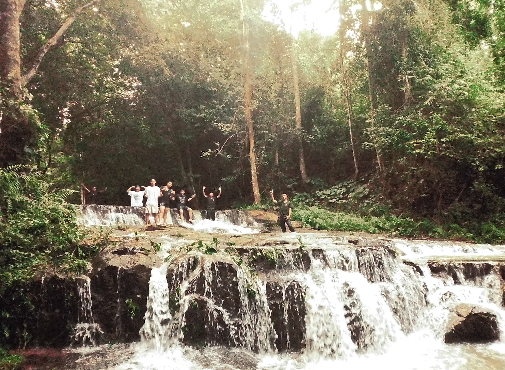
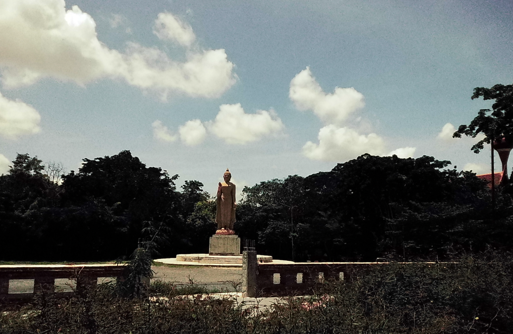
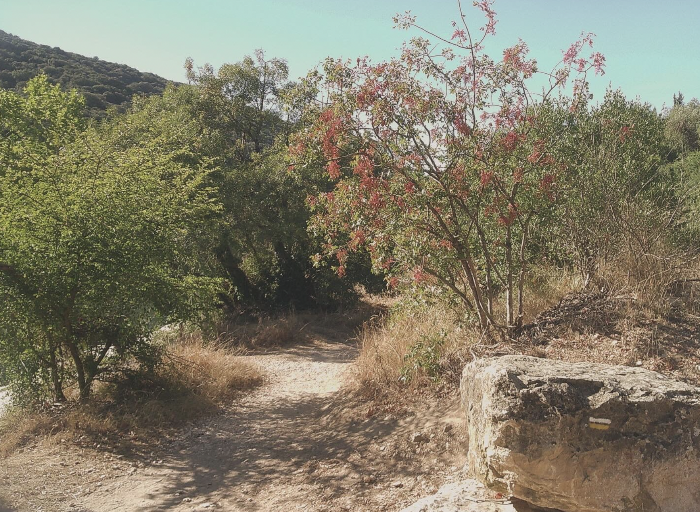
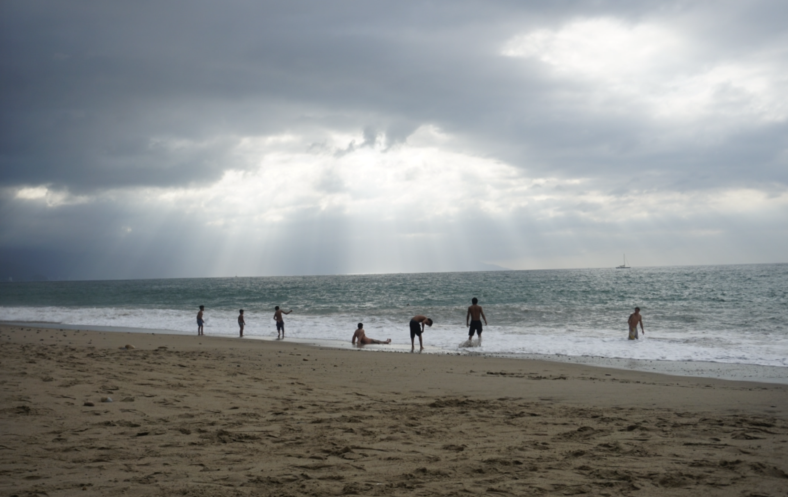

# Hello! 

I grew up in South Central Los Angeles where I explored Southern California's beaches, deserts, and mountains. Environmental justice, stemming from my own experiences of unequal environmental burdens brought me to environmental science, but the methodology behind it are what keep me deeply fascinated by our natural world. My motivation for pursuing a career in environmental data science stems from the principle of serving our communities and ecosystems impacted by climate change. I strongly believe that data-driven solutions are powerful avenue for creating meaningful change. 

 .・。.・゜✭・.

As of late I have been able to travel a bit around the globe, experiencing nature's gifts and the wonderful human beings of the world. Here are some picutres I ♥ 

{width=500px}

{width=500px}

{width=500px}

{width=500px}

more pictures [@algaebloomshere](https://www.instagram.com/algaebloomshere?psln=NTc4MTIwNjQ2YQ%3D%3D&utm_source=qr)